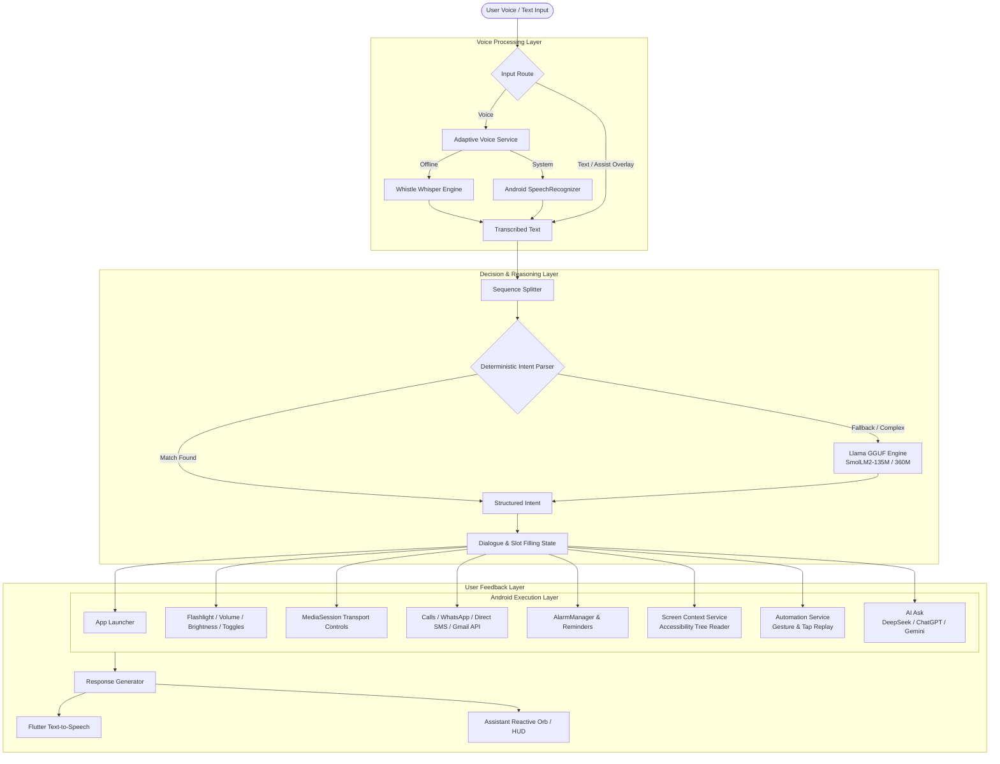

# FRIDAY — Local, Offline Voice AI Assistant for Android

[](https://flutter.dev)
[](https://dart.dev)
[](https://www.android.com)
[]()
[]()

**FRIDAY** is an autonomous, on-device voice AI assistant for Android designed to be fast, capable, and completely private. It executes device actions, controls media and hardware, automates UI workflows, reads active screen contents, and communicates across apps—all without sending personal data, speech recordings, or screen context to cloud servers.

---

## 🌟 Key Capabilities

- **🔒 100% Private & Offline**: Audio processing, LLM inference, screen context reading, and speech synthesis operate directly on your device.
- **⚡ Hybrid Intent Engine**: Zero-latency deterministic parser for instant execution of common device commands, paired with on-device GGUF LLM reasoning (SmolLM2) for natural variations and complex tasks.
- **🎙️ Dual Speech Recognition**:
  - **Whistle STT Engine**: Ultra-compact (~16.9 MB) on-device Whisper model powered by Cactus for complete offline privacy.
  - **Android System SpeechRecognizer**: High-accuracy built-in OS speech services with automatic adaptive fallback.
- **👁️ "Eyes" (Screen Context Awareness)**: Inspects the active app screen via Android's Accessibility Service to summarize articles, read content aloud, or extract and call phone numbers directly from the screen.
- **🦾 "Hands" (Teachable UI Automation)**: Record screen tap and swipe sequences to teach FRIDAY custom multi-step routines, triggered by voice commands with dynamic parameter slots (e.g., `{{contact}}`).
- **🔗 Chained Command Execution**: Execute multi-step sequences in a single breath (e.g., *"Open WhatsApp, set volume to 40%, and turn on the flashlight"*).
- **🔮 Jarvis-Style Assist HUD & Overlay**:
  - Long-press power or home button triggers `AssistActivity` for an instant translucent overlay.
  - Interactive, reactive audio orb (`AssistantOrb`) and status HUD.
- **🎧 Continuous Hands-Free Mode**: Persistent mic listening via a foreground service with wake locks—works while multitasking and when the screen is off.
- **🌐 Multilingual Support**: Handles English, Hindi (Devanagari & transliterated keywords like *"awaaj badhao"*, *"awaaj ghatao"*), and Marathi.

---

## 🏗️ System Architecture



---

## 🗣️ Supported Voice Commands

### 📱 App Launching & Navigation
| Command | Action |
| :--- | :--- |
| `"Open YouTube"` | Launches YouTube |
| `"Launch Chrome"` | Opens Google Chrome |
| `"Start Spotify"` | Opens Spotify |

### 🔦 Hardware & System Toggles
| Command | Action |
| :--- | :--- |
| `"Turn on the flashlight"` / `"Flashlight off"` | Controls device torch |
| `"Turn on Wi-Fi"` / `"Turn off Bluetooth"` | Toggles system radio or opens system settings panel |
| `"Set volume to 50%"` | Sets media volume to absolute level |
| `"Volume up"` / `"Volume down"` | Adjusts volume by configured step |
| `"Mute"` / `"Unmute"` | Mutes media audio or restores previous level |
| `"Set brightness to 70%"` | Sets display brightness directly |
| `"Make it brighter"` / `"Dim the screen"` | Steps screen brightness up or down |

### 🎵 Media & Entertainment
| Command | Action |
| :--- | :--- |
| `"Play music"` / `"Pause"` / `"Resume"` | Controls current active media session |
| `"Next song"` / `"Previous song"` / `"Stop music"` | Navigates media playback |
| `"Open YouTube search hindi music and play first video"` | Searches YouTube and auto-plays the Nth result |
| `"Open gallery and play second video"` | Plays the Nth most recent video from local gallery |

### 👁️ Screen Context Awareness ("Eyes")
| Command | Action |
| :--- | :--- |
| `"What is on my screen?"` | Inspects the active foreground app and summarizes visible content |
| `"Summarize this page"` | Extracts visible text via accessibility tree and generates summary |
| `"Call the number on screen"` | Detects phone numbers visible on screen and places the call |
| `"Read this out loud"` | Reads the text present on the active screen |

### 🦾 Teachable Automation ("Hands")
| Command | Action |
| :--- | :--- |
| `"Run <custom command>"` | Replays recorded tap/swipe sequences through accessibility |
| `"Send message to {{contact}}"` | Replays automated gestures with custom dynamic parameters |
| *Create & Manage* | Open **Settings > My Commands** to record and manage gestures |

### 💬 Communication & Messaging
| Command | Action |
| :--- | :--- |
| `"Call Mom"` / `"Dial 9876543210"` | Resolves contact name via Android Contacts and calls directly |
| `"Send WhatsApp message to Rahul saying I am on my way"` | Opens WhatsApp chat and prepares message |
| `"Read last 5 messages from Alex"` | Reads recent chat messages via accessibility |
| `"Send SMS to FO saying status update"` | Sends direct SMS to recipient/phone number |
| `"Read my unread emails"` | Connects via Gmail API to summarize unread emails in the background |

### ⏰ Alarms, Timers & Reminders
| Command | Action |
| :--- | :--- |
| `"Set an alarm for 7:30 AM"` | Programs exact alarm via Android `AlarmManager` |
| `"Wake me up in 45 minutes"` | Relative time alarm calculation |
| `"Remind me to drink water in 15 minutes"` | Sets time-triggered notification reminder |
| `"Show my alarms"` | Lists all active alarms and reminders |
| `"Cancel my 7 AM alarm"` / `"Cancel all alarms"` | Cancels matching or all alarms |

### 🤖 Cross-App AI Delegation ("AI Ask")
| Command | Action |
| :--- | :--- |
| `"Ask DeepSeek who won the 2024 World Cup"` | Opens DeepSeek, types prompt, and taps Send |
| `"Ask ChatGPT summarize quantum computing"` | Hands prompt off to ChatGPT app directly |
| `"Ask Gemini what are black holes"` | Hands prompt off to Gemini app directly |

### 🔗 Multi-Step Chained Sequences
| Command | Action |
| :--- | :--- |
| `"Open YouTube, set volume to 60%, and turn off flashlight"` | Executes all three operations sequentially |

---

## 🛠️ Hands-Free & Assist Integration

### 1. Hands-Free Mode
- Tap the **Hands-Free** button in the app or say `"Start hands-free mode"`.
- FRIDAY enters a continuous listening loop powered by `HandsFreeForegroundService` with an audio wake lock.
- Issue commands continuously without repeating the wake word.
- Say `"Stop hands-free"` or tap the notification action to exit.

### 2. System Default Assistant (Power / Home Key)
- Configure FRIDAY as your phone's default Digital Assistant app in Android Settings.
- Long-pressing the power button or home button launches `AssistActivity`, displaying the translucent HUD overlay instantly without loading the full app window.

---

## 🧠 Local Models

FRIDAY uses quantized GGUF models running via `llama_flutter_android`:
- **SmolLM2-135M-Instruct (Q4_K_M)**: Extremely lightweight (~105 MB), fast response time.
- **SmolLM2-360M-Instruct (Q4_K_M)**: Higher reasoning accuracy for edge cases.

### Managing Models
- Download directly within the app using the **Download AI Model** button in Settings.
- Or place any compatible GGUF model into the app's local storage directory.

---

## 📂 Repository Structure

```
Operator/
├── android/               # Android native layer, activities & services
│   ├── app/src/main/
│   │   ├── AndroidManifest.xml          # Required permissions & services
│   │   └── kotlin/.../
│   │       ├── AssistActivity.kt        # Quick translucent overlay trigger
│   │       ├── AutomationAccessibilityService.kt # UI automation & screen reading
│   │       ├── AlarmReceiver.kt         # AlarmManager handlers
│   │       └── HandsFreeForegroundService.kt # Background audio service
├── lib/
│   ├── main.dart                        # App entry point & assist gate
│   ├── core/                            # Shared utilities and helpers
│   ├── services/
│   │   ├── voice/                       # Whistle STT & Android STT services
│   │   ├── local_llm/                   # LLaMA runner, ModelManager, Downloader
│   │   ├── tts/                         # Text-to-speech & language settings
│   │   └── assist/                      # System AssistService integration
│   └── features/
│       ├── assistant/                   # Controllers, intent parser, reactive orb UI
│       ├── eyes/                        # Screen context reading & summarization
│       ├── hands/                       # Gesture execution helpers
│       ├── automation/                  # Teachable command recording & storage
│       ├── app_launcher/                # Installed application launching
│       ├── device_control/              # Flashlight, Wi-Fi, Bluetooth
│       ├── volume_control/              # Media volume management
│       ├── brightness_control/          # System brightness adjustments
│       ├── media_control/               # Android MediaSession controls
│       ├── call/                        # ContactsContract phone calling
│       ├── sms/                         # Direct SMS messaging
│       ├── whatsapp/                    # WhatsApp intent automation
│       ├── gmail/                       # Background Google Sign-In & Gmail API
│       ├── youtube/                     # YouTube search & autoplay
│       ├── gallery/                     # MediaStore video retrieval
│       └── alarm/                       # AlarmManager integration & time parsing
└── test/                                # 295+ comprehensive tests
```

---

## 🚀 Getting Started

### Prerequisites
- **Flutter SDK**: `^3.10.4` or higher
- **Android SDK**: Min SDK 26 (Android 8.0), Target SDK 34 (Android 14)
- **Physical Android Device**: Recommended for testing microphone, accessibility, and hardware toggles.

### Installation

1. **Clone the repository**:
   ```bash
   git clone https://github.com/Abhijeet724/Operator.git
   cd Operator
   ```

2. **Install Flutter dependencies**:
   ```bash
   flutter pub get
   ```

3. **Run tests to verify build integrity**:
   ```bash
   flutter test
   ```

4. **Launch the application on an Android device**:
   ```bash
   flutter run
   ```

### Recommended Device Permissions
For full functionality, grant the following permissions when prompted or in Android Settings:
- **Microphone**: Voice command input and offline transcription.
- **Accessibility Service (`FRIDAY Automation`)**: Screen context inspection ("Eyes"), UI gesture replay ("Hands"), and YouTube auto-play.
- **Contacts & Phone**: Contact name resolution and direct dialing.
- **SMS**: Direct SMS sending.
- **Display over other apps**: Translucent HUD overlay for system assist shortcuts.
- **Modify system settings**: Screen brightness adjustments.
- **Alarms & Reminders**: Exact alarm scheduling via AlarmManager.

---

## 🧪 Testing

The codebase includes an extensive suite of **295+ unit and widget tests** covering:
- Deterministic and regex intent parsing (`test/intent_parser_test.dart`)
- Sequence splitting and chained commands (`test/assistant_controller_test.dart`)
- Conversational dialogue states and slot filling (`test/dialogue_state_test.dart`)
- Screen context parsing and phone extraction (`test/screen_context_test.dart`)
- Whistle and System voice services (`test/adaptive_voice_command_service_test.dart`)
- Multilingual keyword detection (`test/language_settings_test.dart`)

Run all tests with:
```bash
flutter test
```

---

## 📄 License

This project is licensed under the terms specified in the repository.